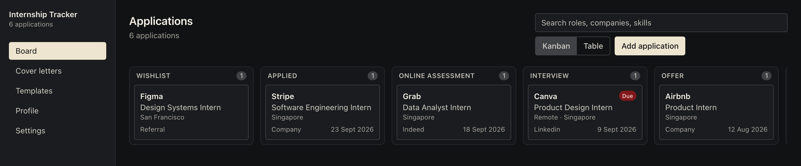
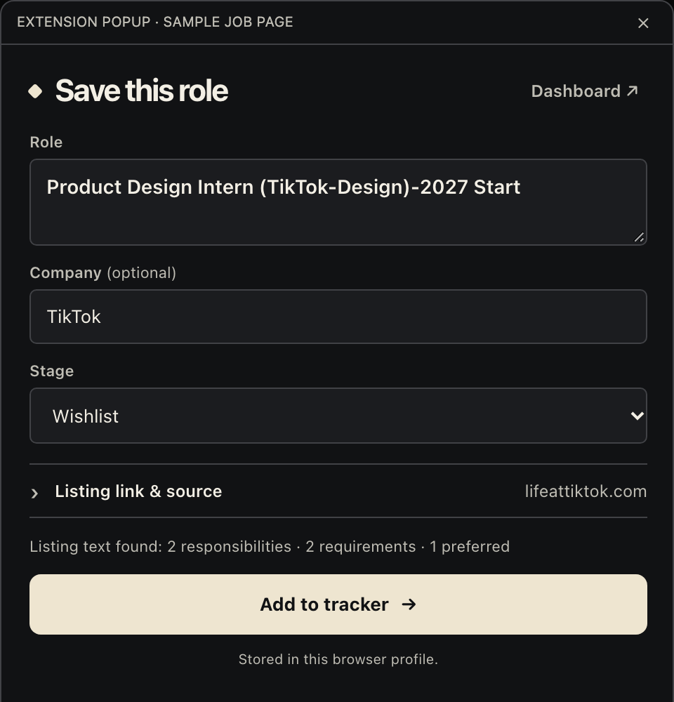
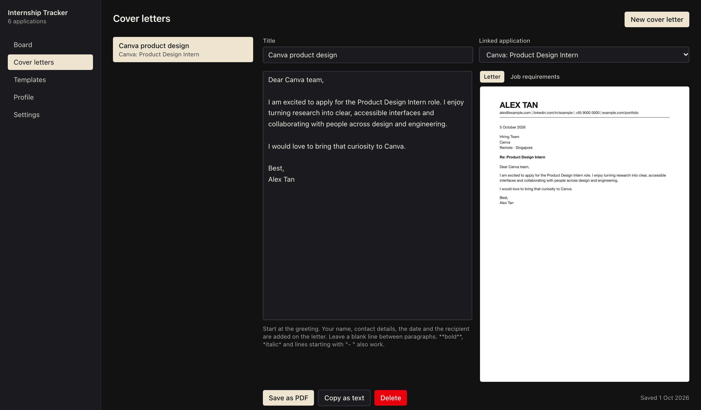

# Internship Tracker

A Chrome and Brave extension for tracking internship applications, cover letters and your resume. Everything is stored locally in the browser (IndexedDB); nothing is sent anywhere.







The screenshots come from the local preview (`npm run preview`), which seeds sample data.

## Features

- Board of applications by status (wishlist, applied, OA, interview, offer, rejected, withdrawn), with a table view
- One-click capture from LinkedIn, Indeed, Glassdoor, Life at TikTok and most company career pages. The extension reads only the tab you click it on.
- Saves each listing's responsibilities, requirements and full text with the application, so they survive the listing being taken down. Board search covers them, so searching a skill finds the roles that ask for it.
- Cover letters laid out as an A4 letter with your name, contact details, the date and the recipient, saved as PDF through the print dialog. The job's requirements sit beside the editor while you write.
- Letter templates with `{company}`, `{role}`, `{date}` and `{name}` placeholders
- Profile page with resume upload, preview and reusable resume bullets
- Deadline and follow-up dates, with due and overdue items highlighted on the board
- Full JSON backup and restore, CSV export

## Install (Chrome or Brave)

1. `npm install`
2. `npm run build` (output in `dist/`)
3. Open `chrome://extensions` (or `brave://extensions`), turn on Developer mode
4. Click Load unpacked and pick the `dist/` folder
5. Pin the extension. `Alt+Shift+I` opens the dashboard.

## Develop

```
npm run dev
```

Load `dist/` as above; the page reloads when you save. Built with Vite, React, TypeScript, Tailwind, Dexie and CRXJS.
